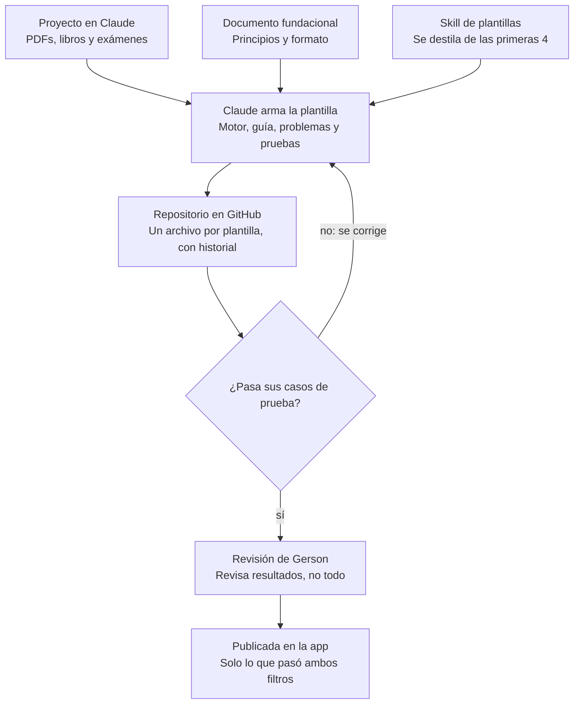
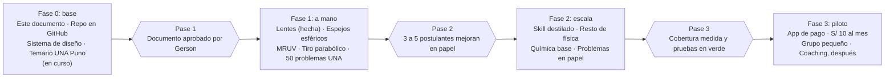

# Laboratorio de Admisión — Documento fundacional

4 de noviembre de 2026 · Gerson

> Copia del documento vivo: https://claude.ai/artifact/1R3XjJwYibxXWnEGSkHRNV
> Si se edita allá, actualizar esta copia (o al revés) para que no se separen.

## Propósito y alcance

El laboratorio es una app de bajo costo (meta: S/ 10 al mes) que convierte los problemas de admisión en escenas visuales donde cada variable de la ecuación está amarrada a algo que se ve. Es para postulantes de universidades peruanas cuyas familias no pueden pagar una academia (alrededor de S/ 200 al mes) ni profesores particulares.

**Qué resuelve.** El postulante no se traba en la cuenta: se traba antes, al pasar del enunciado al modelo físico. El laboratorio le muestra ese paso: del texto al dibujo y del dibujo a la ecuación, con los mismos colores en los tres.

**Qué no promete.**

- No reemplaza lápiz y papel. El examen se rinde sin calculadora y con un par de minutos por pregunta; la app entrena la comprensión y la práctica escrita la consolida.
- No resuelve problemas por el alumno. Si el alumno solo mira, aprende poco: cada escena le pide una predicción antes de mostrar el resultado.
- No cubre al inicio todo el examen. Empieza por física y química, donde el puente visual rinde más, y amplía según lo que muestren las pruebas con estudiantes.

**Prueba de concepto.** El Banco Óptico (`plantillas/optica-lente-delgada/`, lente sola y sistemas de 2 o 3 lentes) es la primera versión del formato y el ejemplo de referencia de este documento.

## Principios pedagógicos

Toda plantilla cumple seis principios. Cada uno tiene evidencia publicada detrás y una regla de diseño concreta; si una plantilla rompe una regla, debe justificarlo por escrito.

| Principio | Qué dice la evidencia | Regla en el laboratorio |
| --- | --- | --- |
| Predecir antes de ver | Ver una demostración de física sin más no mejora la comprensión frente a no verla; predecir el resultado antes sí la mejora de forma significativa ([Crouch, Fagen, Callan y Mazur, 2004](https://www.compadre.org/IntroPhys/items/detail.cfm?ID=2329)). | Cada escena se pausa al menos una vez y pide una predicción con un toque. No se avanza sin responder. |
| Palabra e imagen juntas y señaladas | Se aprende mejor con palabras e imágenes juntas, cerca en la pantalla, al mismo tiempo y con señales que marquen lo esencial ([Mayer, 2020](https://ugc.futurelearn.com/uploads/files/7d/d6/7dd6188d-c343-4311-b064-ac98d2c95abc/Multimedia_Principles._R._E._Mayer__2020.pdf): multimedia, contigüidad espacial y temporal, señalización). | Cada variable tiene un color fijo en el enunciado, el dibujo y la ecuación. Tocar un símbolo ilumina su objeto en la escena. |
| Nada que sobre, en segmentos | Quitar material decorativo y partir la lección en segmentos que el alumno controla mejora el aprendizaje (Mayer, 2020: coherencia, segmentación). | Sin adornos en la escena. Guía por pasos cortos con botones de avanzar y retroceder. |
| Participación activa | En 62 cursos de física con 6.542 estudiantes, los cursos de participación activa duplicaron la ganancia normalizada de los tradicionales: 0,48 frente a 0,23 ([Hake, 1998](https://web.mit.edu/jrankin/www/Active_Learning/hake_active_phys.pdf)). Las simulaciones diseñadas con investigación mejoran el dominio de conceptos ([Wieman, Adams y Perkins, 2008](https://www.compadre.org/portal/items/detail.cfm?ID=8511)). | Cada plantilla termina en un explorador donde el alumno manipula la escena y ve la ecuación cambiar en vivo. |
| Ayuda que se retira | Los ejemplos resueltos que van quitando pasos ayudan en varios estudios, pero no siempre: con alumnos de poca base, retirar la ayuda demasiado rápido les rinde menos ([Reisslein, Atkinson y otros, 2006](https://faculty.engineering.asu.edu/mre/wp-content/uploads/sites/31/2020/02/Exp_Rev_LI06.pdf)). | Primero el problema resuelto completo; luego variantes donde el alumno completa el último paso, después los dos últimos. El ritmo se ajusta a sus aciertos, no a un calendario fijo. |
| Recordar en vez de releer | Releer rinde más a los 5 minutos, pero practicar el recuerdo rinde más a la semana ([Roediger y Karpicke, 2018](https://moodle2.units.it/pluginfile.php/572734/mod_resource/content/1/testing.pdf), revisión de su estudio de 2006). | Cada plantilla trae problemas para resolver en papel, sin la escena, y se repasan días después. |

**Simulaciones en general.** Un metaanálisis de 59 estudios encontró que las simulaciones mejoran el rendimiento en ciencias frente a la enseñanza sin ellas (g = 0,62), y que agregarles andamiaje (pasos guiados, pistas, preguntas) suma un efecto adicional (g = 0,60) ([D'Angelo y otros, SRI, 2014](https://www.sri.com/wp-content/uploads/2021/12/simulations-for-stem-learning-executive-summary.pdf)). Una revisión de estudios experimentales concluye lo mismo: las simulaciones mejoran la enseñanza tradicional, sobre todo como complemento del laboratorio ([Rutten, van Joolingen y van der Veen, 2012](https://www.compadre.org/portal/items/detail.cfm?ID=16323)). Eso respalda el formato completo del laboratorio: simulación más guía paso a paso, no simulación suelta.

**Errores típicos como material.** Las opciones de cada predicción no son inventadas: salen de confusiones documentadas o, cuando no hay estudios, de errores observados en postulantes. En lentes, la investigación documenta bien los errores conceptuales (tapar media lente borra media imagen: 66 % de 70 escolares en [John y otros, 2017](https://www.ejmste.com/download/south-african-learners-conceptual-understanding-about-image-formation-by-lenses-4741.pdf); sin pantalla no hay imagen: 80 %), pero no los de cálculo que más pregunta el examen (sumar aumentos en vez de multiplicarlos, olvidar el signo de una imagen virtual, usar la separación entre lentes como distancia del objeto). Esos se tratan como hipótesis hasta confirmarlos con soluciones escritas de postulantes. Detalle en [`investigacion/optica-ideas-erroneas.md`](investigacion/optica-ideas-erroneas.md). Cuando el alumno elige una opción, la escena le muestra qué pasaría si eso fuera cierto.

**Lápiz y papel.** La app explica; el papel fija. Es la aplicación directa de los dos últimos principios y la razón por la que el laboratorio se presenta como complemento, no como reemplazo.

**Qué tan respaldados estamos.** El diseño tiene buen respaldo: cada regla sale de hallazgos replicados y de metaanálisis. El producto todavía no: no hay evidencia de que **esta** app funcione con **estos** alumnos. Tres huecos concretos:

- Casi todos los estudios son con universitarios de Estados Unidos y Europa, no con postulantes peruanos.
- Miden comprensión de conceptos, no puntaje en un examen de admisión con tiempo limitado.
- No hay estudios sobre usar la app sola desde el celular, sin profesor al lado.

Esos huecos no se llenan leyendo más: se llenan con la prueba del pase 2 de la hoja de ruta. Lo que sí falta leer, y se hará tema por tema, es la investigación sobre las ideas erróneas típicas de cada tema (óptica, dinámica, estequiometría), que alimenta las opciones de predicción.

## Taxonomía inicial

El laboratorio arranca con física y química: tienen el mayor peso de ciencias en las áreas de ingeniería y ciencias, y son donde el puente visual rinde más. En San Marcos 2026-I, de 100 preguntas por área, física y química suman 14 en Ciencias Básicas, 13 en Ingeniería y 12 en Ciencias de la Salud ([Infobae](https://www.infobae.com/peru/2025/08/15/asi-se-estructurara-el-examen-de-admision-de-san-marcos-2026-i-esta-es-la-cantidad-de-preguntas-por-asignatura-segun-el-area/)). La UNI les dedica un día entero de examen ([Gestión](https://gestion.pe/peru/admision-2026-ii-uni-aqui-el-link-de-los-resultados-del-examen-noticia/)).

La jerarquía es **curso → tema → plantilla → tipo de pregunta**. Una plantilla es un motor de escena que cubre una familia de problemas (por ejemplo, "lente delgada" cubre objeto real, imagen virtual y sistemas de lentes). Las tablas son una propuesta: los temarios oficiales de la UNI y San Marcos vienen dentro de sus prospectos de admisión, que no están publicados en abierto. La UNSAAC sí publica sus temarios por curso en su servidor de admisión ([física](http://ccomputo.unsaac.edu.pe/admision/files/temario/fisicaa.pdf)), pero no se pudo abrir en la primera búsqueda. Del temario de la UNSA no se encontró una versión pública. La única lista oficial leída es la de [La Molina 2024](https://cdn.lamolina.edu.pe/v1/AUTH_90afa410262f41f1af475ed599eeb798/lamolina-admision/website/2024/TEMARIO%20EXAMEN/1TemarioExamen2024.pdf), ampliada con los temas habituales de la UNI y San Marcos.

### Física

| Tema | Plantillas propuestas | Potencial visual |
| --- | --- | --- |
| Cinemática | MRU y encuentros; MRUV; caída libre; tiro parabólico; MCU y MCUV; lectura de gráficas x-t y v-t | Alto |
| Dinámica y estática | Diagrama de cuerpo libre; plano inclinado; poleas y bloques; equilibrio y torque | Alto |
| Trabajo, energía y momento | Conservación de energía; choques; impulso | Alto |
| Óptica | Lente delgada (hecha); espejos esféricos; refracción y reflexión total | Alto |
| Electricidad | Circuitos en serie y paralelo; ley de Coulomb y campo eléctrico | Alto |
| Magnetismo | Fuerza sobre carga y corriente; inducción | Medio: el campo no se ve, la escena es un modelo |
| Fluidos | Presión hidrostática; empuje y flotación | Alto |
| Calor | Calorimetría y cambios de fase; dilatación | Medio |
| Ondas y MAS | Resorte y péndulo; ondas en cuerdas | Alto |
| Vectores y análisis dimensional | Suma de vectores; análisis dimensional | Medio en vectores, bajo en análisis dimensional |
| Física moderna | Efecto fotoeléctrico | Bajo: casi todo es conceptual |

### Química

| Tema | Plantillas propuestas | Potencial visual |
| --- | --- | --- |
| Estequiometría y unidades químicas | Mol, masa y partículas; reactivo limitante; rendimiento | Alto |
| Gases | Ley general y gases ideales; mezclas y presiones parciales | Alto |
| Soluciones | Concentración; dilución y mezcla; titulación | Alto |
| Equilibrio y ácido-base | Le Chatelier; pH | Medio |
| Materia, átomo y tabla periódica | Estructura atómica; configuración electrónica; tendencias periódicas | Medio |
| Enlace y reacciones | Enlace y geometría molecular; balanceo; redox | Medio |
| Nomenclatura y orgánica | Inorgánica; hidrocarburos y grupos funcionales | Bajo: es memoria y reglas, no un fenómeno que se mueva |

**Alcance ampliado (decisión de Gerson, 4 de noviembre de 2026):** entran también aritmética, álgebra, geometría, trigonometría, razonamiento matemático y razonamiento verbal. No todos se enseñan con una escena: cada curso usa el formato que mejor le calza (escena, predicciones rápidas o lectura), y la arquitectura permite agregar cursos y unidades sin tocar código. Ver [`arquitectura.md`](arquitectura.md) y el catálogo en `catalogo/`. Biología y los cursos de letras quedan para después; el catálogo ya los admite.

**Pendiente:** subir los prospectos de la UNI y San Marcos y los temarios de la UNSAAC, la UNSA y la UNA Puno, y fijar la taxonomía con ellos (la UNI como techo de dificultad). Después, clasificar unos 50 problemas reales por plantilla: eso dice qué porcentaje del examen cubre el laboratorio y en qué orden construir.

## Especificación de una plantilla

Una plantilla tiene siete partes fijas. Las primeras cinco son lo que ve el alumno; las dos últimas, lo que garantiza que la física es correcta.

1. **Motor de escena.** Código determinístico que dibuja el fenómeno a partir de sus parámetros. La física vive aquí y en ningún otro lado. En el Banco Óptico, el motor traza los rayos con la regla de la lente delgada (pendiente de salida = pendiente de entrada − y/f), así que el dibujo nunca contradice a la ecuación.
2. **Mapa de variables.** Cada símbolo tiene un color, un nombre en palabras y un objeto en la escena: o naranja es la cota entre objeto y lente, f violeta son los focos, i verde azulado es la cota de la imagen, h rojo son las flechas. El mapa es el mismo en el enunciado, el dibujo y las ecuaciones.
3. **Problema guiado.** Un problema típico, con números que dan resultados limpios, en pasos de este orden:
   1. El enunciado con los datos coloreados.
   2. Del texto al dibujo: dónde vive cada dato.
   3. La predicción, que bloquea el avance hasta responder.
   4. La construcción animada (rayos, fuerzas, trayectorias), una pieza a la vez y con el porqué físico de cada una.
   5. La ecuación, armada con los mismos colores.
   6. La respuesta, contrastada con la predicción.
   7. El explorador.
4. **Predicciones con errores típicos.** Cuatro opciones como máximo; las incorrectas salen de confusiones reales y cada una tiene su explicación.
5. **Explorador.** El alumno manipula la escena (arrastrando o con deslizadores) y ve las ecuaciones recalcularse en vivo. Incluye los casos límite que el examen ama: objeto en el foco, imagen virtual, objeto virtual en sistemas de lentes.
6. **Problemas para papel.** De 5 a 10 problemas propios, del mismo tipo, con respuesta y solución escrita, para resolver sin la escena y repasar días después.
7. **Casos de prueba.** Pares de entrada y salida que el motor debe reproducir con una tolerancia, verificados con cálculo independiente. Ejemplos del Banco Óptico (también en `plantillas/optica-lente-delgada/casos.json`):

| Caso | Entrada | Salida esperada |
| --- | --- | --- |
| Lente sola, objeto lejano | o = 30 cm, f = 10 cm, h = 4 cm | i = 15 cm, A = −0,5, hᵢ = −2 cm |
| Lente sola, objeto en el foco | o = 10 cm, f = 10 cm | Sin imagen (rayos paralelos) |
| Lente sola, lupa | o = 5 cm, f = 10 cm | i = −10 cm, A = +2, virtual |
| Dos lentes convergentes | o₁ = 15, f₁ = 10, d = 50, f₂ = 10 (cm) | i₁ = 30, o₂ = 20, i₂ = 20 (cm), A = +2 |
| Objeto virtual | o₁ = 15, f₁ = 10, d = 25, f₂ = 10 (cm) | o₂ = −5 cm, i₂ ≈ 3,33 cm, A ≈ −1,33 |

Una plantilla no se publica si no pasa todos sus casos de prueba. Los colores, la tipografía y la disposición vienen de un sistema de diseño común a todas, para que el alumno no tenga que reaprender la interfaz en cada tema.

## Arquitectura de producción

La cuenta dedicada de Claude produce las plantillas; el repositorio guarda la verdad; las pruebas automáticas y la revisión de Gerson deciden qué se publica.

La revisión periódica mira el resultado de las pruebas y una muestra de plantillas en uso; no hace falta leer todo el código.

- **Proyecto en Claude:** guarda los PDFs como material de consulta. Ahí se sabe qué se pregunta; no es fuente para copiar (ver la sección de fuentes).
- **Repositorio:** contiene este documento, el sistema de diseño, una carpeta por plantilla (motor, guía, problemas, casos de prueba) y el banco de problemas reales etiquetados.
- **Skill de plantillas:** se escribe después de construir a mano las cuatro primeras, cuando el patrón ya esté probado. Antes de eso, codificaría suposiciones.
- **Trabajo programado:** una tarea recurrente puede avanzar la cola de plantillas pendientes, pero nunca publica sin pasar los dos filtros.

## Uso de fuentes y derechos

Los libros, manuales y exámenes que se suban sirven para saber **qué** se enseña y **cómo** se pregunta, no como texto para copiar. Todo el contenido publicado en la app es redacción propia.

| Fuente | Uso permitido en el laboratorio | Uso que no se hace |
| --- | --- | --- |
| Manuales de academias (Lumbreras, cepres, separatas) | Mapear temas, estilos de pregunta y errores frecuentes | Copiar sus problemas, soluciones, gráficos o teoría en una app de pago |
| Libros de texto | Consultar la teoría y verificar fórmulas | Reproducir párrafos, figuras o listas de ejercicios |
| Exámenes de admisión publicados por las universidades | Clasificar preguntas por plantilla y medir cobertura; inspirar problemas propios del mismo tipo | Publicarlos tal cual sin revisar antes cómo los licencia cada universidad |
| Problemas propios | Todo: guía, explorador, papel, casos de prueba | — |

**Regla práctica:** un problema propio cambia el contexto, los números y la pregunta respecto al original, y se verifica con el motor de la plantilla antes de publicarse.

Esto no es asesoría legal. Antes de cobrar, conviene una consulta corta con un abogado de propiedad intelectual sobre el uso de exámenes públicos.

## Hoja de ruta

El siguiente paso es cerrar la fase 0 y construir a mano las cuatro primeras plantillas; la escala llega recién cuando postulantes reales demuestren que aprenden con ellas.

Cada pase exige evidencia, no solo trabajo terminado. Las fases no tienen fechas aún: se ponen cuando se cierre la fase 0.

**Cambio de plan (decisión de Gerson, 5 de noviembre de 2026).** No habrá prueba previa con postulantes. El prototipo se lanza directamente en un colegio, y ahí se evalúa casi todo. Como Claude programa rápido, se llega con un prototipo bastante más avanzado que un producto mínimo. Consecuencias:

- El pase 2 deja de ser una puerta antes de construir: se mide en el colegio, con el mismo criterio de abajo (cuenta el papel, no la opinión).
- La app tiene que traer su propia medición, porque no habrá otra oportunidad de recoger datos antes. Debe registrar, de forma anónima, las predicciones y las pruebas de antes y después.
- Sin datos previos, las opciones de predicción se apoyan en la investigación de `docs/investigacion/`. Las que hoy son hipótesis se confirman o se descartan con los datos del colegio.

**Cómo se mide el pase 2.** De 3 a 5 postulantes reales, de academia o del entorno, resuelven en papel un problema del tema. Luego usan la plantilla unos 10 minutos y resuelven en papel un problema nuevo del mismo tipo. Pasa si la mayoría resuelve el segundo y no resolvía el primero. Lo que digan ("qué bonito") no cuenta; cuenta el papel.

**Preguntas abiertas**

- [ ] ¿Cómo licencia la UNA Puno sus exámenes pasados?
- [ ] ¿Celular primero? La mayoría de postulantes usará la app desde el celular, así que arrastrar en pantalla táctil es la interacción principal.
- [ ] ¿Funciona sin internet estable? En provincias la conexión es irregular; las plantillas deberían poder usarse sin conexión.

## Fuentes

- [Crouch, Fagen, Callan y Mazur (2004), *Classroom demonstrations: Learning tools or entertainment?*](https://www.compadre.org/IntroPhys/items/detail.cfm?ID=2329)
- [Mayer (2020), *Multimedia Learning*, principios](https://ugc.futurelearn.com/uploads/files/7d/d6/7dd6188d-c343-4311-b064-ac98d2c95abc/Multimedia_Principles._R._E._Mayer__2020.pdf)
- [Hake (1998), *Interactive-engagement versus traditional methods*](https://web.mit.edu/jrankin/www/Active_Learning/hake_active_phys.pdf)
- [Wieman, Adams y Perkins (2008), *PhET: Simulations That Enhance Learning*](https://www.compadre.org/portal/items/detail.cfm?ID=8511)
- [Reisslein, Atkinson, Seeling y Reisslein (2006), sobre ejemplos resueltos y desvanecimiento](https://faculty.engineering.asu.edu/mre/wp-content/uploads/sites/31/2020/02/Exp_Rev_LI06.pdf)
- [Roediger y Karpicke (2018), *Reflections on the resurgence of interest in the testing effect*](https://moodle2.units.it/pluginfile.php/572734/mod_resource/content/1/testing.pdf)
- [D'Angelo, Rutstein, Harris, Bernard, Borokhovski y Haertel (2014), *Simulations for STEM Learning: Systematic Review and Meta-Analysis*, SRI](https://www.sri.com/wp-content/uploads/2021/12/simulations-for-stem-learning-executive-summary.pdf)
- [Rutten, van Joolingen y van der Veen (2012), *The learning effects of computer simulations in science education*](https://www.compadre.org/portal/items/detail.cfm?ID=16323)
- [Infobae: estructura del examen de San Marcos 2026-I](https://www.infobae.com/peru/2025/08/15/asi-se-estructurara-el-examen-de-admision-de-san-marcos-2026-i-esta-es-la-cantidad-de-preguntas-por-asignatura-segun-el-area/)
- [Gestión: cronograma del examen UNI 2026-II](https://gestion.pe/peru/admision-2026-ii-uni-aqui-el-link-de-los-resultados-del-examen-noticia/)
- [John, Molepo y Chirwa (2017), *South African Learners' Conceptual Understanding about Image Formation by Lenses*](https://www.ejmste.com/download/south-african-learners-conceptual-understanding-about-image-formation-by-lenses-4741.pdf)
- [Wörner y otros (2022), *Converging Lenses Concept Inventory*](https://arxiv.org/abs/2205.09861)
- [Temario de admisión UNALM 2024](https://cdn.lamolina.edu.pe/v1/AUTH_90afa410262f41f1af475ed599eeb798/lamolina-admision/website/2024/TEMARIO%20EXAMEN/1TemarioExamen2024.pdf)
- [UNSAAC: temario de física de admisión](http://ccomputo.unsaac.edu.pe/admision/files/temario/fisicaa.pdf) (enlace localizado; el 4 de noviembre devolvió error 503)
