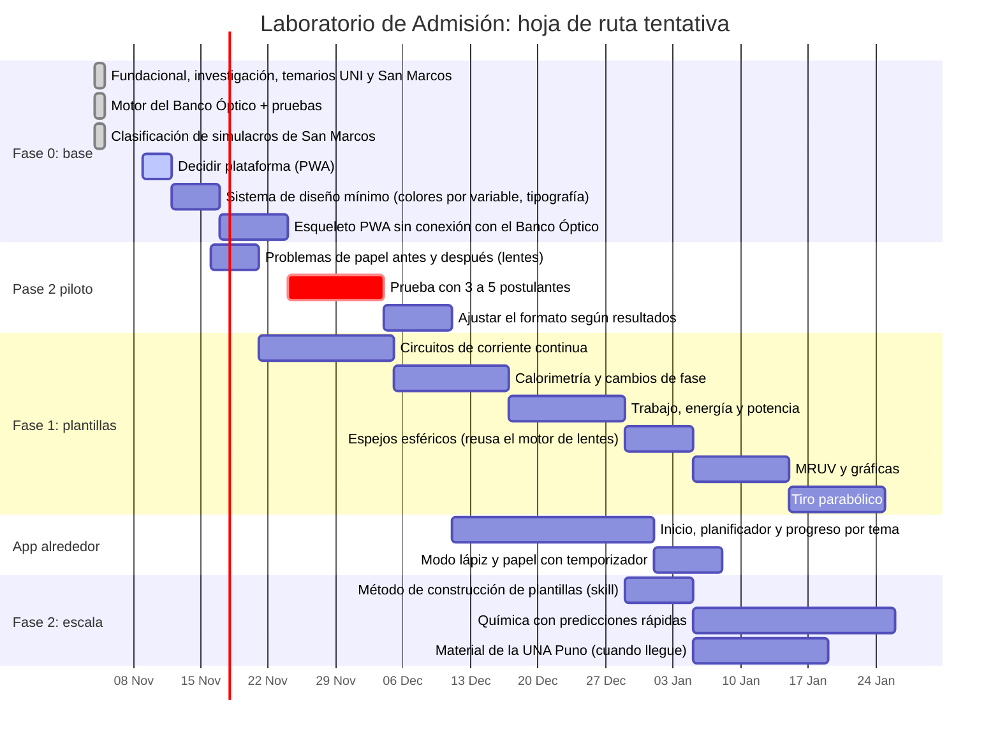

# Hoja de ruta y pendientes

4 de noviembre de 2026 · Propuesta para que Gerson la ajuste. Las fechas son tentativas: el fundacional dice que las fases tienen fecha recién al cerrar la fase 0, y esta es la propuesta para cerrarla.

## La idea en una línea

Primero se demuestra que **una plantilla hace aprender** (pase 2). Después se construye la app alrededor. Una app bonita con planner, racha y temporizador se puede copiar en semanas; lo que no se puede copiar es la escena que hace entender y la evidencia de que funciona.

## Orden propuesto

1. **Cerrar la fase 0 (noviembre).** Decidir la plataforma, armar un sistema de diseño mínimo y un esqueleto de app que funcione sin conexión y que ya incluya el Banco Óptico.
2. **Pase 2 piloto, con lo que ya existe (noviembre a diciembre).** Probar el Banco Óptico con 3 a 5 postulantes, en papel antes y después. No hace falta construir nada nuevo: se prueba el *formato*, no la cobertura. Si falla, se corrige antes de hacer diez plantillas iguales.
3. **Plantillas de alto rendimiento para la UNI y San Marcos (fines de noviembre a enero).** Primero circuitos, calorimetría y trabajo y energía, que cubren el 28 % de la física de San Marcos y también están en la UNI. Después espejos, MRUV y tiro parabólico, que pesan más en la UNI.
4. **La app alrededor (diciembre a enero, en paralelo).** Inicio, planificador por semana del CEPRE, progreso por tema del temario y modo "lápiz y papel" con temporizador. Ver la [referencia de interfaz](referencias/ui-study-planner-pinterest.jpg).
5. **Escala (desde enero).** Destilar el método de construcción de plantillas (tarea 6), química con predicciones rápidas, más universidades.
6. **Visión a futuro, después del piloto pagado.** Todos los grados, seguimiento adaptativo, curaduría de videos, historia ([`vision-futura.md`](vision-futura.md)).

## Gantt

Con este calendario, las primeras plantillas estarían listas antes de que arranquen los ciclos CEPRE de marzo de 2027.

## Estado de los pendientes

| Tarea (`CLAUDE.md`) | Estado | Siguiente paso |
| --- | --- | --- |
| 1. Motor del Banco Óptico con pruebas | Hecho | Es el molde para las demás plantillas |
| 2. Temarios | UNI y San Marcos hechos | UNA Puno, UNSA y UNSAAC cuando haya material |
| 3. Clasificar problemas reales | San Marcos hecho (120 preguntas) | UNI, si se consiguen exámenes; UNA Puno |
| 4. Investigación de errores típicos | Física y química hechas | Confirmar hipótesis en el pase 2 |
| 5. Construir plantillas | 1 de 4 (Banco Óptico) | Circuitos |
| 6. Método de construcción | Pendiente | Después de 4 plantillas probadas |
| 7. Visión a futuro | Anotada | No se toca hasta el piloto pagado |

## Plataforma: web app instalable (PWA)

Propuesta: una **PWA**, es decir, una página web que se instala en el celular como app y funciona sin internet.

| Criterio | PWA | App nativa (Play Store) |
| --- | --- | --- |
| Funciona sin conexión | Sí (con *service worker*) | Sí |
| Costo de publicar y actualizar | Casi cero; se actualiza sola | Cuenta de desarrollador y revisión de cada versión |
| Celulares Android de gama baja | Liviana, sin instalar nada pesado | Ocupa más espacio |
| Lo que ya tenemos | El Banco Óptico ya es HTML y JavaScript: entra tal cual | Habría que rehacerlo o envolverlo |
| Cobro de S/ 10 al mes | Pagos web (Yape, tarjeta); sin comisión de tienda | La tienda cobra comisión |
| Notificaciones de repaso | Sí en Android; limitadas en iPhone | Completas |

La PWA gana en casi todo para este público. Si más adelante hace falta estar en la Play Store, una PWA se puede empaquetar como app sin rehacerla.

## Referencia de interfaz

La [imagen de referencia](referencias/ui-study-planner-pinterest.jpg) (un *study planner* de Pinterest) tiene cuatro pantallas. Así se traducen al laboratorio:

| Pantalla de la referencia | En el laboratorio |
| --- | --- |
| Inicio: meta del día y agenda | Las plantillas y repasos del día, según la semana del ciclo CEPRE de su universidad |
| Planificador: semana y tareas | El cronograma del CEPRE-UNI o del CEPRE-UNMSM, tema por tema, con los repasos que tocan (recordar en vez de releer) |
| Temporizador de enfoque | El modo **lápiz y papel**: problemas sin la escena, con tiempo de examen (unos 2 minutos por pregunta) |
| Progreso por materia | Avance por **tema del temario** y aciertos en las predicciones; la racha de días va aquí |

Se toma la estructura de la referencia, no su diseño: los colores de la app los manda la regla de un color por variable, y el morado de la referencia chocaría con los colores de las escenas.
