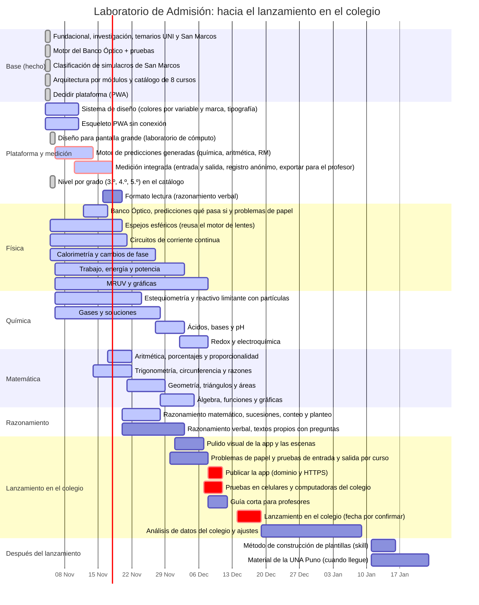

# Hoja de ruta y pendientes

5 de noviembre de 2026 · Rehecha tras la decisión de Gerson: el prototipo se lanza en un colegio en diciembre de 2026, sin prueba previa con alumnos. Las fechas son editables en el Gantt (`npm run dev`).

## El lanzamiento

| Dato | Lo que se sabe |
| --- | --- |
| Dónde | Un colegio. Ahí se evalúa casi todo. |
| Cuándo | Diciembre de 2026. La fecha exacta está por confirmar; el plan asume la semana del 14. |
| Quiénes | 3.º, 4.º y 5.º de secundaria |
| En qué | En el celular de cada alumno y en el laboratorio de cómputo |
| Qué cursos | Física, química, matemática (aritmética, álgebra, geometría y trigonometría) y razonamiento (matemático y verbal) |
| Feedback previo | Ninguno. Se va con un prototipo bastante más avanzado que un producto mínimo. |

## La idea en una línea

Como no hay prueba previa, **la app tiene que medir por sí misma**: pruebas cortas de entrada y salida por tema, y registro anónimo de cada predicción. Sin eso, el lanzamiento no deja evidencia de si los alumnos aprendieron.

## Orden propuesto

1. **Plataforma y medición (hasta el 17 de noviembre).**
   - Lo que más trabajo ahorra: el **motor de predicciones generadas**, que sirve a química, aritmética y razonamiento matemático, y la **medición integrada**, que es la única fuente de datos.
   - Lo que exige el colegio: el diseño para pantalla grande del laboratorio y el **nivel por grado** de cada unidad (3.º, 4.º y 5.º no ven lo mismo).
2. **Contenido de los cuatro bloques, en paralelo (del 12 de noviembre al 7 de diciembre).** Pocos módulos por curso, pero completos: predicción con errores típicos, explicación, problemas de papel y casos de prueba.
   - **Física:** Banco Óptico completo, espejos, circuitos, calorimetría, energía y MRUV.
   - **Química:** reactivo limitante con partículas, gases y soluciones, pH, redox.
   - **Matemática:** trigonometría, geometría y funciones con escena; aritmética con predicciones.
   - **Razonamiento:** matemático con predicciones generadas; verbal con textos propios.
3. **Preparar el lanzamiento (del 30 de noviembre al 11 de diciembre).**
   - Pruebas de entrada y salida por curso.
   - Pruebas en celulares y computadoras como las del colegio.
   - Publicar la app con dominio y HTTPS.
   - Una guía corta para profesores.
4. **Lanzamiento (semana del 14 de diciembre) y análisis de datos** hasta inicios de enero.
5. **Después:** destilar el método de construcción de plantillas, la UNA Puno y la [visión a futuro](vision-futura.md).

**El riesgo principal no es el código, es el contenido.** Cada módulo necesita problemas propios, verificados y con errores típicos bien elegidos (reglas 2, 3, 5 y 6). Es mejor llegar con menos módulos completos que con muchos a medias: un módulo flojo en el colegio da datos que no sirven.

## Cómo verla y actualizarla

```bash
npm run dev
```

Abre <http://localhost:4173/gestion/>. Ahí se navega por días, semanas o meses, se edita una tarea con un clic, se arrastra una barra para moverla (o su borde para alargarla) y se guarda con el botón o con Ctrl+S. Al guardar se actualizan `docs/hoja-de-ruta.json` (la única fuente) y el Gantt de abajo, que GitHub dibuja solo. La app está en <http://localhost:4173/app/>.

## Gantt

Con este calendario, las primeras plantillas estarían listas antes de que arranquen los ciclos CEPRE de marzo de 2027.



## Estado de los pendientes

| Tarea (`CLAUDE.md`) | Estado | Siguiente paso |
| --- | --- | --- |
| 1. Motor del Banco Óptico con pruebas | Hecho | Es el molde para las demás plantillas |
| 2. Temarios | UNI y San Marcos hechos | UNA Puno, UNSA y UNSAAC cuando haya material |
| 3. Clasificar problemas reales | San Marcos hecho (120 preguntas) | UNI, si se consiguen exámenes; UNA Puno |
| 4. Investigación de errores típicos | Física y química hechas | Confirmar hipótesis en el pase 2 |
| 5. Construir plantillas | 1 de 4 (Banco Óptico) | Circuitos |
| 6. Método de construcción | Pendiente | Después de 4 plantillas probadas |
| 7. Visión a futuro | Anotada | No se toca hasta el piloto pagado |

## Plataforma: web app instalable (PWA)

Propuesta: una **PWA**, es decir, una página web que se instala en el celular como app y funciona sin internet.

| Criterio | PWA | App nativa (Play Store) |
| --- | --- | --- |
| Funciona sin conexión | Sí (con *service worker*) | Sí |
| Costo de publicar y actualizar | Casi cero; se actualiza sola | Cuenta de desarrollador y revisión de cada versión |
| Celulares Android de gama baja | Liviana, sin instalar nada pesado | Ocupa más espacio |
| Lo que ya tenemos | El Banco Óptico ya es HTML y JavaScript: entra tal cual | Habría que rehacerlo o envolverlo |
| Cobro de S/ 10 al mes | Pagos web (Yape, tarjeta); sin comisión de tienda | La tienda cobra comisión |
| Notificaciones de repaso | Sí en Android; limitadas en iPhone | Completas |

La PWA gana en casi todo para este público. Si más adelante hace falta estar en la Play Store, una PWA se puede empaquetar como app sin rehacerla.

## Referencia de interfaz

Hay dos referencias: un [*study planner* de Pinterest](referencias/ui-study-planner-pinterest.jpg), del que sale la estructura de cuatro pantallas, y una [app de ejercicio](referencias/ui-fitness-dribbble.webp), de la que salen el estilo (tarjetas redondeadas, morado con acento lima, "reto del día", estadísticas de hoy, progreso en anillo) y la bienvenida. Así se traducen al laboratorio:

| Pantalla de la referencia | En el laboratorio |
| --- | --- |
| Inicio: meta del día y agenda | Las plantillas y repasos del día, según la semana del ciclo CEPRE de su universidad |
| Planificador: semana y tareas | El cronograma del CEPRE-UNI o del CEPRE-UNMSM, tema por tema, con los repasos que tocan (recordar en vez de releer) |
| Temporizador de enfoque | El modo **lápiz y papel**: problemas sin la escena, con tiempo de examen (unos 2 minutos por pregunta) |
| Progreso por materia | Avance por **tema del temario** y aciertos en las predicciones; la racha de días va aquí |

El morado y el lima de la marca se usan solo en la cáscara de la app (inicio, cursos, progreso, perfil). Dentro de una escena no aparecen, porque ahí el morado es la distancia focal y el verde, la separación entre lentes (regla 4). La primera versión está en `app/`.
